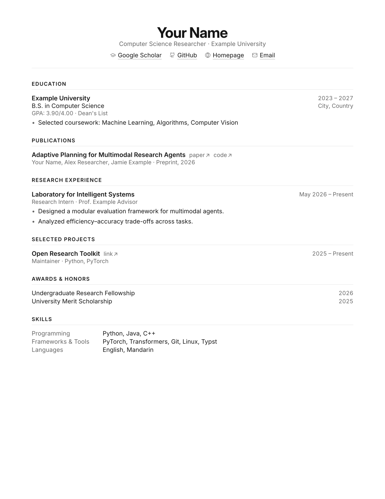
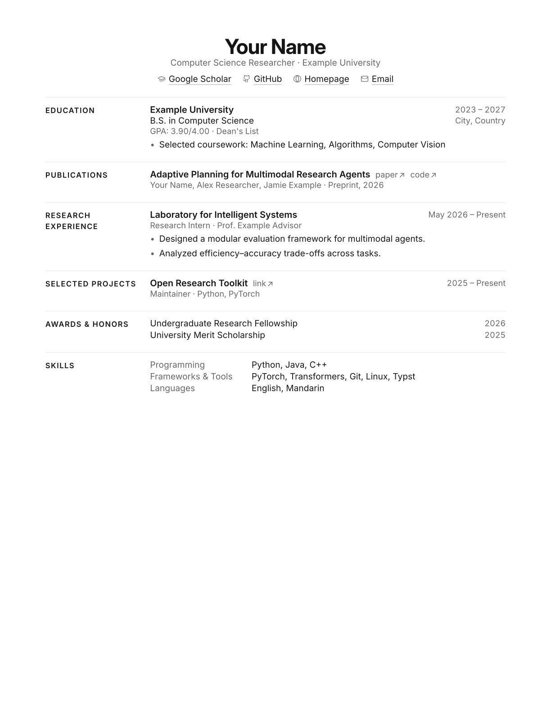
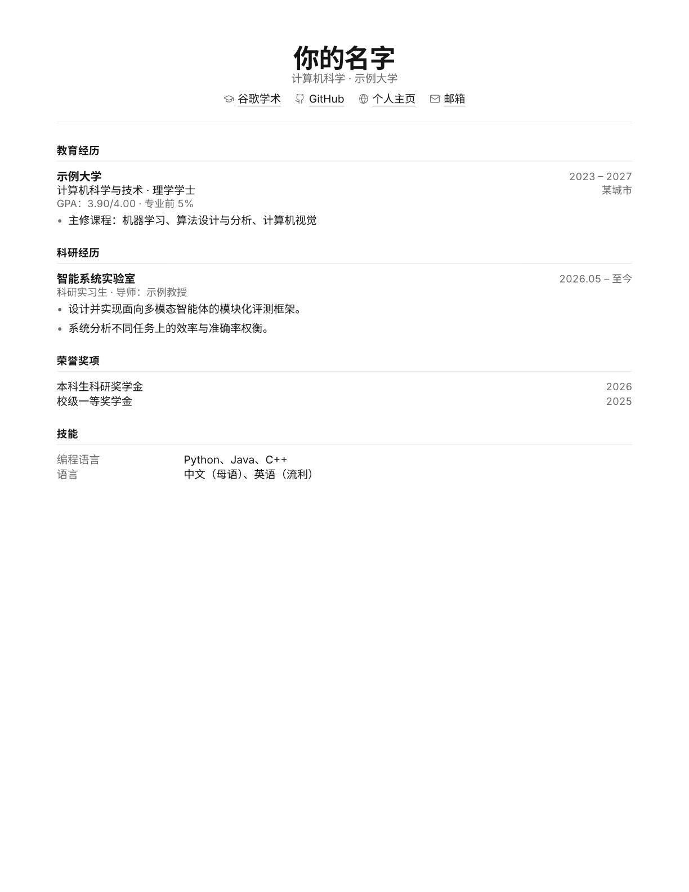

# Scholarline CV

A minimal, customizable academic CV template for [Typst](https://typst.app/).

Monochrome, typography-led, and quiet: Inter, a grayscale palette, small uppercase section labels over hairlines, and a left-content / right-date grid. Everything beyond a tiny core is a plugin: the header, sections, section headings, entry links, icons, and every component can be replaced or extended with the same primitives the built-ins use.

**Status:** v0.1.0 prototype (unreleased). All examples are anonymous placeholders.

| Default | `margin-section` plugin | Chinese |
|---|---|---|
|  |  |  |

More combinations are shown in the [plugin guide](docs/PLUGINS.md#gallery).

## Quick start

Install Typst 0.13 or newer plus two free fonts: [Inter](https://rsms.me/inter/) and [Noto Sans CJK SC](https://github.com/notofonts/noto-cjk). Noto Sans CJK SC renders Chinese, and its Latin glyphs stand in if Inter is missing. In the Typst web app, Noto Sans CJK SC is built in, so upload only Inter's TTF files (including `InterDisplay-Bold.ttf`, used for the name) to your project. Prefer system fonts? Use `theme: (font: "Helvetica Neue", cjk-font: "PingFang SC")`.

```sh
typst compile main.typ
typst compile --root . examples/zh.typ
typst compile --root . examples/custom-links.typ
```

If the fonts are not installed system-wide, put their files in `fonts/` and add `--font-path fonts`.

## Customize

```typst
#import "lib.typ": *

#show: cv.with(
  name: "Your Name",
  subtitle: "Computer Science Researcher · Example University",
  contacts: (
    contact("GitHub", "https://github.com", icon: "github"),
    contact("Email", "mailto:you@example.com", icon: "email"),
  ),
  theme: (paper: "a4", spacing: 1.1),                     // tokens: colours, fonts, size, spacing, paper
  plugins: (section: margin-section),                     // swap or wrap any built-in part
)
```

- `lang: "zh"` for a Chinese CV; bilingual CVs keep `lang: "en"` and write `section("教育经历 Education")`.
- Built-in plugin presets: `margin-section` (section labels in a left column) and `underline-links` (underlined entry links instead of `paper ↗`).
- Write your own components with `entry`, `entry-title`, `entry-meta`, `entry-links`, `dot-join`, and `cv-icon`.

See [docs/PLUGINS.md](docs/PLUGINS.md) for plugins and recipes, and [docs/API.md](docs/API.md) for the full API.

## Development

```sh
tests/run.sh --font-path fonts   # compile-based tests
docs/gallery/build.sh            # re-render docs/images for every plugin combination
```

`tests/pass/*.typ` must compile (they use `#assert`); `tests/fail/*.typ` must fail with the message on their `// expect:` line. This repository is not yet published on Typst Universe.

## License

MIT. Icons are derived from [Lucide](https://lucide.dev) (ISC); see `assets/icons/LICENSE`.
